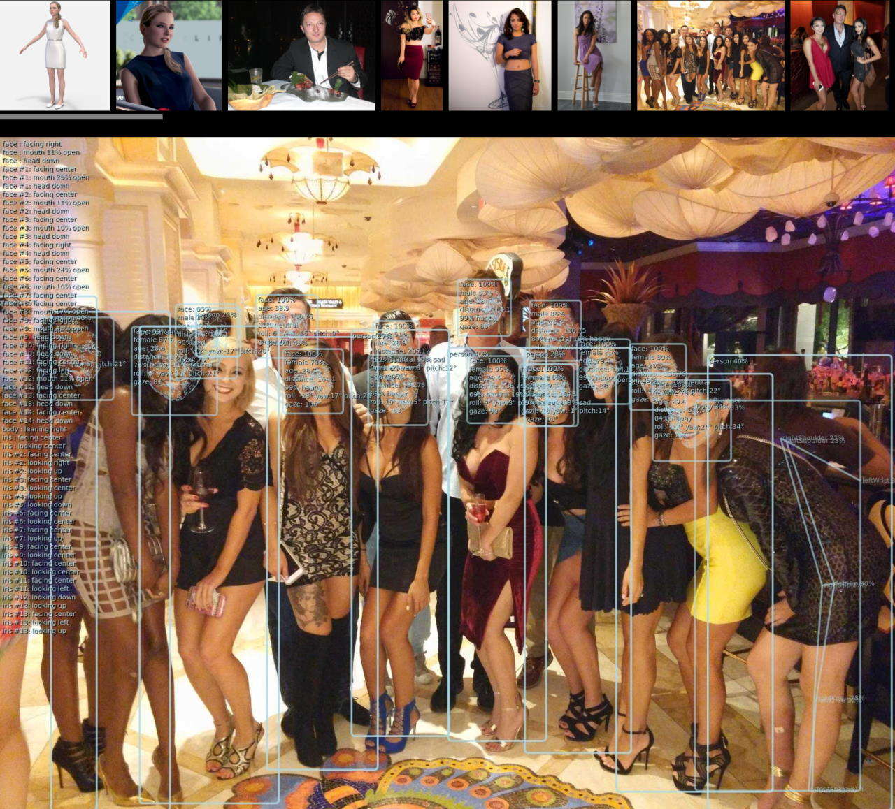
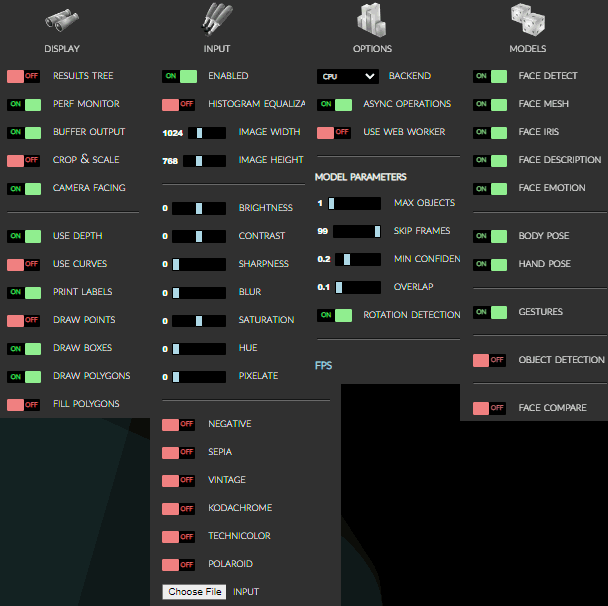
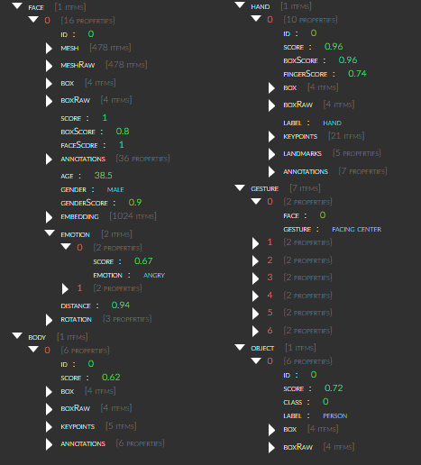
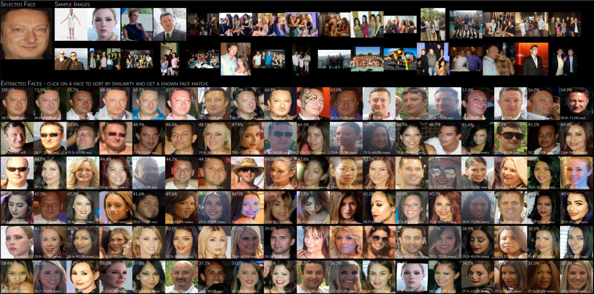
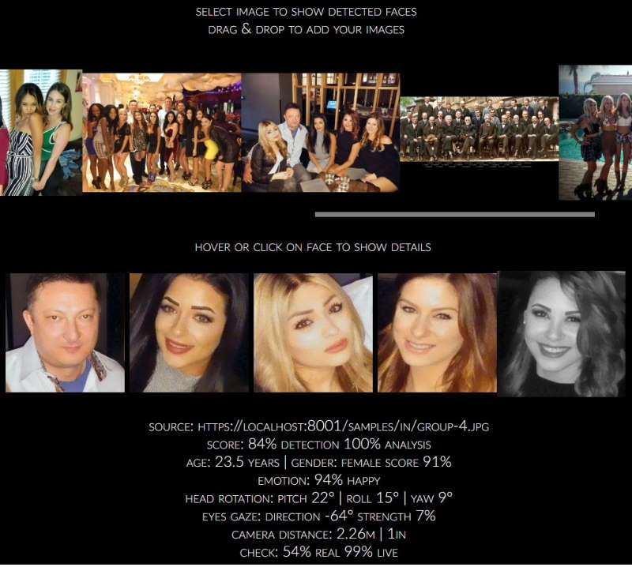
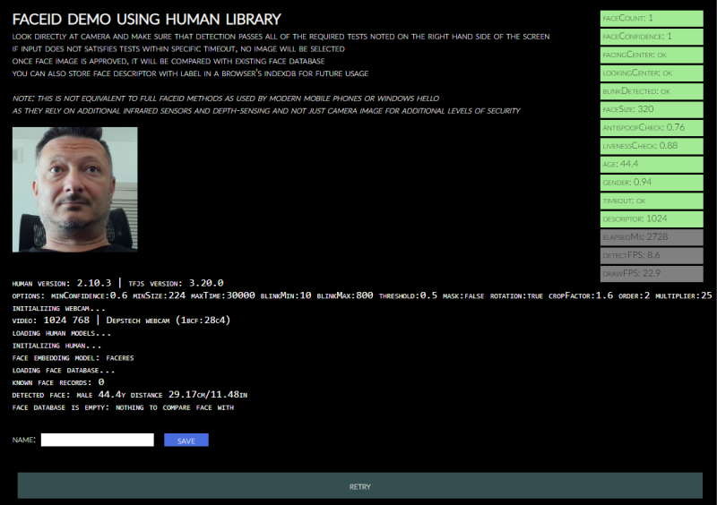
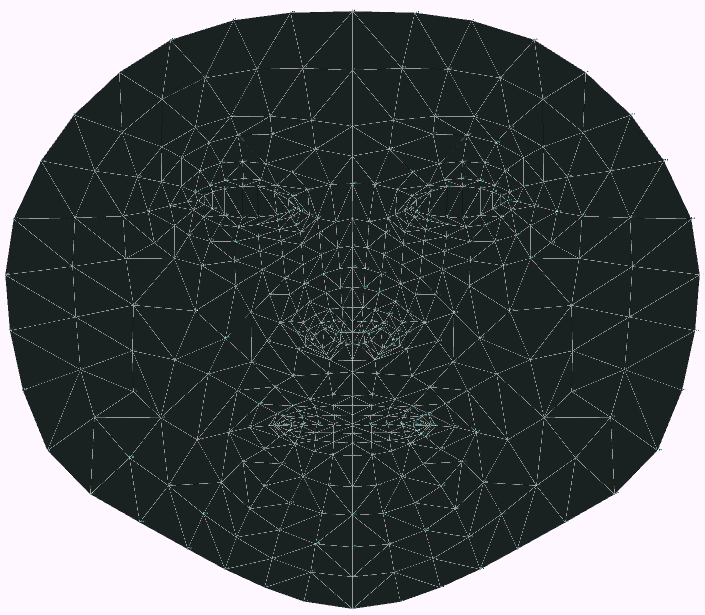

# human

**AI-powered 3D Face Detection & Rotation Tracking, Face Description & Recognition,**  
**Body Pose Tracking, 3D Hand & Finger Tracking, Iris Analysis,**  
**Age & Gender & Emotion Prediction, Gaze Tracking, Gesture Recognition, Body Segmentation**  

Developed and maintained by **Nima Dorostkar** ([@nimadorostkar](https://github.com/nimadorostkar))

**Live demos:** <https://nimadorostkar.github.io/human/>  
**npm:** [`@nimadorostkar/human`](https://www.npmjs.com/package/@nimadorostkar/human)

<br>

## Highlights

- Runs in the browser (WebGPU, WebGL, WASM, CPU) and in Node.js  
- Combines multiple machine learning models that can be switched on demand for each use case  
- Related models run in an attention pipeline, so details are computed only when needed  
- Optimized input pre-processing that can enhance image quality of any input  
- Detects frame changes and runs only the models that are required  
- Temporal interpolation for smooth results regardless of processing speed  
- Simple unified API  
- Built-in image, video and webcam handling

[*Jump to Quick Start*](#quick-start)

<br>

## Run it locally

Requirements: **Node.js 22** (see [`.nvmrc`](.nvmrc)) and **npm**, plus a modern browser (Chrome/Edge recommended).

```bash
git clone https://github.com/nimadorostkar/human.git
cd human
nvm use
npm ci --ignore-scripts
npm run serve
```

Then open:

- Main demo: <http://localhost:8000> (the server also listens on <https://localhost:8001>)
- Simple TypeScript demo: <http://localhost:8000/demo/typescript/index.html>
- Examples gallery: <http://localhost:8000/samples/index.html>

The repository already ships a pre-built library in `dist/` and all models in `models/`, so the demos work offline without a build step.

**Notes**

- `--ignore-scripts` skips native builds of `@tensorflow/tfjs-node`, `@tensorflow/tfjs-node-gpu` and `canvas`. Browser demos and `npm run build` do not need them.
- To run the Node.js demos or `npm test`, build the native modules once on Node 22: `npm rebuild @tensorflow/tfjs-node canvas`
- Webcam access needs `localhost` or HTTPS. Allow camera access when the browser asks.

### Scripts

| Command | What it does |
| --- | --- |
| `npm run serve` | Start the local dev server on ports 8000 (HTTP) and 8001 (HTTPS) |
| `npm run dev` | Dev server plus file watching and incremental rebuilds |
| `npm run compile` | Re-bundle `dist/` and the TypeScript demos with esbuild |
| `npm run build` | Full production build: `dist/`, `types/`, `typedoc/`, lint and model manifest |
| `npm run lint` | Lint the sources |
| `npm run typecheck` | Type-check with `tsc` |
| `npm test` | Run the Node.js tests and demos (needs native `tfjs-node`; set `HUMAN_TEST_GPU=true` to include the CUDA backend test) |
| `npm start` | Run the main Node.js demo (needs native `tfjs-node`) |

<br>

## Compatibility

**Browser**:  
  - Desktop and mobile platforms  
  - *WebGPU*, *WebGL*, *WASM*, *CPU* backends  
  - *WebWorker* execution  
  - *WebView*  
  - Primary platform: *Chromium*-based browsers  
  - Secondary platform: *Firefox*, *Safari*

**Node.js**:  
  - *WASM* backend for architectures where *tensorflow* binaries are not available  
  - *tfjs-node* using software execution via *tensorflow* shared libraries  
  - *tfjs-node-gpu* using GPU-accelerated execution via *tensorflow* shared libraries and NVIDIA CUDA  
  - Supported versions are **18.x** to **22.x** (the native `tfjs-node` bindings do not support newer releases yet; the WASM backend works on any version)  

<br>

## Demos

All demos are in the [`demo/`](demo) folder and run from the local dev server (`npm run serve`).

### Browser Demos

*All browser demos are self-contained without any external dependencies*

| Demo | Local URL | Source | Description |
| --- | --- | --- | --- |
| **Full** | <http://localhost:8000/demo/index.html> | [demo](demo) | Main demo that showcases all capabilities |
| **Simple** | <http://localhost:8000/demo/typescript/index.html> | [demo/typescript](demo/typescript) | Annotated webcam demo in TypeScript, a good starting point |
| **Embedded** | <http://localhost:8000/demo/video/index.html> | [demo/video](demo/video/index.html) | Tiny demo with code embedded in a single HTML file |
| **Face Detect** | <http://localhost:8000/demo/facedetect/index.html> | [demo/facedetect](demo/facedetect) | Extract faces from images and show details |
| **Face Match** | <http://localhost:8000/demo/facematch/index.html> | [demo/facematch](demo/facematch) | Compute face descriptors and match them against a known database |
| **Face ID** | <http://localhost:8000/demo/faceid/index.html> | [demo/faceid](demo/faceid) | Validate webcam input is a real face, then match it to faces stored in IndexedDB |
| **Multi-thread** | <http://localhost:8000/demo/multithread/index.html> | [demo/multithread](demo/multithread) | Run each module in its own web worker |
| **Segmentation** | <http://localhost:8000/demo/segmentation/index.html> | [demo/segmentation](demo/segmentation) | Body segmentation and background replacement |
| **Tracker** | <http://localhost:8000/demo/tracker/index.html> | [demo/tracker](demo/tracker) | Object and face tracking across frames |

In the main demo:

- To start video detection, press *Play*  
- To process images, drag and drop them into the browser window  
- For best performance, enable only the models you need
- With a modern GPU, the *WebGL* (default) backend is preferred, otherwise select *WASM*

### Node.js Demos

*Node.js demos may need extra dependencies to decode inputs; see the header of each demo*

- **Main** ([demo/nodejs/node.js](demo/nodejs/node.js)): Process images from files, folders or URLs  
- **Canvas** ([demo/nodejs/node-canvas.js](demo/nodejs/node-canvas.js)): Draw results to a new image file using `node-canvas`  
- **Video** ([demo/nodejs/node-video.js](demo/nodejs/node-video.js)): Process video input using `ffmpeg`  
- **WebCam** ([demo/nodejs/node-webcam.js](demo/nodejs/node-webcam.js)): Process webcam screenshots using `fswebcam`  
- **Events** ([demo/nodejs/node-event.js](demo/nodejs/node-event.js)): Get notifications on processing through events
- **Similarity** ([demo/nodejs/node-similarity.js](demo/nodejs/node-similarity.js)): Compare two images for similarity of detected faces
- **Face Match** ([demo/facematch/node-match.js](demo/facematch/node-match.js)): Parallel face matching in worker threads
- **Multiple Workers** ([demo/multithread/node-multiprocess.js](demo/multithread/node-multiprocess.js)): Dispatch work to a pool of worker processes  
- **Dynamic Load** ([demo/nodejs](demo/nodejs)): Load the library with different backends  

<br>

## Project pages

- [**Code Repository**](https://github.com/nimadorostkar/human)
- [**Issues Tracker**](https://github.com/nimadorostkar/human/issues)
- [**TypeDoc API Specification - Main class**](typedoc/classes/Human.html) (local: <http://localhost:8000/typedoc/classes/Human.html>)
- [**TypeDoc API Specification - Full**](typedoc/index.html) (local: <http://localhost:8000/typedoc/>)
- [**Change Log**](CHANGELOG.md)
- [**To-do List**](TODO.md)
- [**Contributing**](CONTRIBUTING)
- [**Security & Privacy Policy**](SECURITY.md)
- [**License & Usage Restrictions**](LICENSE)

<br>

## App Examples

[](assets/samples.jpg)

<br>

## Options

All options as presented in the demo application:  
[demo/index.html](demo/index.html)  
[](assets/screenshot-menu.png)

<br>

**Results Browser:**  
[ *Demo -> Display -> Show Results* ]<br>
[](assets/screenshot-results.png)

<br>

## Advanced Examples

1. **Face Similarity Matching:**  
Extracts all faces from the input images, sorts them by similarity to a selected face  
and optionally matches the face against a database of known people to guess their names
> [demo/facematch](demo/facematch/index.html)  

[](assets/screenshot-facematch.jpg)

2. **Face Detect:**  
Extracts all detected faces from loaded images and highlights face details on a selected face  
> [demo/facedetect](demo/facedetect/index.html)  

[](assets/screenshot-facedetect.jpg)

3. **Face ID:**  
Validates that the webcam input shows a real face and matches it to known faces stored in a database
> [demo/faceid](demo/faceid/index.html)  

[](assets/screenshot-faceid.jpg)

<br>

**468-Point Face Mesh Details:**  
(view in full resolution to see keypoints)  

[](assets/facemesh.png)

<br><hr><br>

## Quick Start

Install from npm:

```bash
npm install @nimadorostkar/human
```

Use it with a bundler (Vite, webpack, esbuild, Next.js):

```js
import { Human } from '@nimadorostkar/human';

const human = new Human({ modelBasePath: '/models/' }); // serve the files from node_modules/@nimadorostkar/human/models
```

Or load it straight from a CDN without a build step:

```html
<script src="https://cdn.jsdelivr.net/npm/@nimadorostkar/human/dist/human.js"></script>
<script>
  const human = new Human.Human({ modelBasePath: 'https://cdn.jsdelivr.net/npm/@nimadorostkar/human/models/' });
</script>
```

Or in Node.js, together with a TensorFlow backend:

```js
const tf = require('@tensorflow/tfjs-node'); // load backend before human
const { Human } = require('@nimadorostkar/human');

const human = new Human({ modelBasePath: 'file://node_modules/@nimadorostkar/human/models/' });
```

<br>

## Code Examples

Simple app that uses `human` to process video input and  
draw output on screen using the built-in draw helpers

```js
// create instance of human with simple configuration using default values
const config = { backend: 'webgl' };
const human = new Human.Human(config);
// select input HTMLVideoElement and output HTMLCanvasElement from page
const inputVideo = document.getElementById('video-id');
const outputCanvas = document.getElementById('canvas-id');

function detectVideo() {
  // perform processing using default configuration
  human.detect(inputVideo).then((result) => {
    // result object will contain detected details
    // as well as the processed canvas itself
    // so lets first draw processed frame on canvas
    human.draw.canvas(result.canvas, outputCanvas);
    // then draw results on the same canvas
    human.draw.face(outputCanvas, result.face);
    human.draw.body(outputCanvas, result.body);
    human.draw.hand(outputCanvas, result.hand);
    human.draw.gesture(outputCanvas, result.gesture);
    // and loop immediate to the next frame
    requestAnimationFrame(detectVideo);
    return result;
  });
}

detectVideo();
```

or using `async/await`:

```js
const config = { backend: 'webgl' };
const human = new Human(config); // create instance of Human
const inputVideo = document.getElementById('video-id');
const outputCanvas = document.getElementById('canvas-id');

async function detectVideo() {
  const result = await human.detect(inputVideo); // run detection
  human.draw.all(outputCanvas, result); // draw all results
  requestAnimationFrame(detectVideo); // run loop
}

detectVideo(); // start loop
```

or using `Events`:

```js
const config = { backend: 'webgl' };
const human = new Human(config); // create instance of Human
const inputVideo = document.getElementById('video-id');
const outputCanvas = document.getElementById('canvas-id');

human.events.addEventListener('detect', () => { // event gets triggered when detect is complete
  human.draw.all(outputCanvas, human.result); // draw all results
});

function detectVideo() {
  human.detect(inputVideo) // run detection
    .then(() => requestAnimationFrame(detectVideo)); // upon detect complete start processing of the next frame
}

detectVideo(); // start loop
```

or using interpolated results for smooth video by separating detection and drawing loops:

```js
const human = new Human(); // create instance of Human
const inputVideo = document.getElementById('video-id');
const outputCanvas = document.getElementById('canvas-id');
let result;

async function detectVideo() {
  result = await human.detect(inputVideo); // run detection
  requestAnimationFrame(detectVideo); // run detect loop
}

async function drawVideo() {
  if (result) { // check if result is available
    const interpolated = human.next(result); // get smoothened result using last-known results
    human.draw.all(outputCanvas, interpolated); // draw the frame
  }
  requestAnimationFrame(drawVideo); // run draw loop
}

detectVideo(); // start detection loop
drawVideo(); // start draw loop
```

or using the built-in webcam helper that handles video completely:

```js
const human = new Human(); // create instance of Human
const outputCanvas = document.getElementById('canvas-id');

async function drawResults() {
  const interpolated = human.next(); // get smoothened result using last-known results
  human.draw.canvas(outputCanvas, human.webcam.element); // draw current webcam frame
  human.draw.all(outputCanvas, interpolated); // draw the frame detection results
  requestAnimationFrame(drawResults); // run draw loop
}

await human.webcam.start({ crop: true });
human.video(human.webcam.element); // start detection loop which continuously updates results
drawResults(); // start draw loop
```

For even better performance, run detection in a separate web worker (see [demo/multithread](demo/multithread))

<br><hr><br>

## Inputs

`human` can process all common input types:  

- `Image`, `ImageData`, `ImageBitmap`, `Canvas`, `OffscreenCanvas`, `Tensor`,  
- `HTMLImageElement`, `HTMLCanvasElement`, `HTMLVideoElement`, `HTMLMediaElement`

`HTMLVideoElement` and `HTMLMediaElement` can be a standard `<video>` tag that links to:

- A webcam on the user's system
- Any supported video type, e.g. `.mp4`, `.avi`
- Additional video types via *HTML5 Media Source Extensions*,  
  e.g. **HLS** using `hls.js` or **DASH** using `dash.js`
- A **WebRTC** media track using built-in support  

<br><hr><br>

## TypeDefs

`human` is written in TypeScript and ships full **TypeDefs** for all classes in `types/human.d.ts`, enabled by default  

*Note*: This does not include the embedded `tfjs`  
To use the embedded `tfjs` (`human.tf` namespace) with full typedefs, add:

> import type * as tfjs from '@nimadorostkar/human/dist/tfjs.esm';  
> const tf = human.tf as typeof tfjs;

This needs these dev-only dependencies for the types:

> @tensorflow/tfjs-core, @tensorflow/tfjs-converter, @tensorflow/tfjs-backend-wasm, @tensorflow/tfjs-backend-webgl

<br><hr><br>

## Default models

- **Face Detection**: *MediaPipe BlazeFace Back variation*
- **Face Mesh**: *MediaPipe FaceMesh*
- **Face Iris Analysis**: *MediaPipe Iris*
- **Face Description**: *HSE FaceRes*
- **Emotion Detection**: *Oarriaga Emotion*
- **Body Analysis**: *MoveNet Lightning variation*
- **Hand Analysis**: *HandTrack & MediaPipe HandLandmarks*
- **Body Segmentation**: *Google Selfie*
- **Object Detection**: *CenterNet with MobileNet v3*

Alternative models are included in [`models/`](models) and can be enabled through configuration (see [`src/config.ts`](src/config.ts)).  
For example, body pose detection uses *MoveNet Lightning* by default, but can switch to *MoveNet Thunder* for higher precision, *MoveNet MultiPose* for multiple people, or *PoseNet*, *BlazePose* or *EfficientPose*.

<br><hr><br>

## Production

### Deploy the demo site

- **GitHub Pages:** every push to `main` builds the project and publishes the demos, models and API docs with [`.github/workflows/pages.yml`](.github/workflows/pages.yml). Enable it once under *Settings → Pages → Source: GitHub Actions*.
- **Docker:** a multi-stage [`Dockerfile`](Dockerfile) builds everything and serves it with unprivileged nginx on port 8080, with security headers, gzip, long-lived caching for models and bundles, and a `/healthz` endpoint:

  ```bash
  docker build -t human .
  docker run --rm -p 8080:8080 human
  ```

  Webcam demos need HTTPS outside `localhost`, so put the container behind a TLS-terminating proxy.
- **Any static host:** run `npm run build && ./deploy/site.sh _site` and upload the `_site` folder.

### Publish a release

1. Update the version in `package.json` and add an entry to [`CHANGELOG.md`](CHANGELOG.md)
2. Commit, then tag and push: `git tag v1.0.1 && git push origin main --tags`
3. [`.github/workflows/release.yml`](.github/workflows/release.yml) checks that the tag matches `package.json`, builds, publishes to npm with provenance and creates a GitHub release

The release workflow needs an npm automation token saved as the `NPM_TOKEN` repository secret.

### Continuous integration

[`.github/workflows/ci.yml`](.github/workflows/ci.yml) runs lint, type-checking, the full build, a package dry-run and the Node.js test suite on every push and pull request. CodeQL scans the code weekly and Dependabot keeps dependencies and actions current.

<br><hr><br>

## Tech stack

Written in [TypeScript](https://www.typescriptlang.org/) **5.9** using [TensorFlow/JS](https://www.tensorflow.org/js/) **4.22**  
Build target for distributables is `JavaScript` [ECMAScript 2018](https://262.ecma-international.org/9.0/)  

<br><hr><br>

## Author

**Nima Dorostkar**  
GitHub: [@nimadorostkar](https://github.com/nimadorostkar)  
Email: <nimadorostkar97@gmail.com>

## Acknowledgements

`human` is based on the open-source [Human](https://github.com/vladmandic/human) library by Vladimir Mandic, released under the MIT License.  
Thanks also to the authors of the underlying models; see the upstream [list of models and credits](https://github.com/vladmandic/human/wiki/Models).

## License

[MIT](LICENSE)
