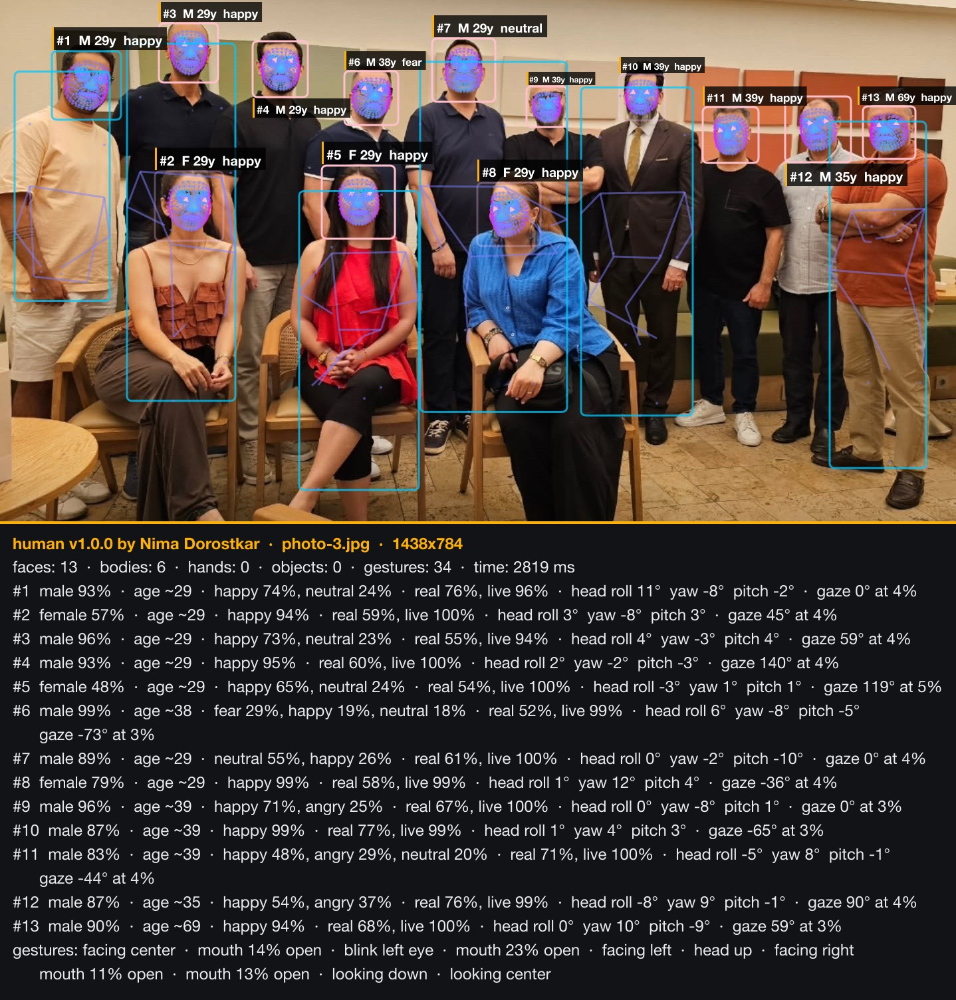
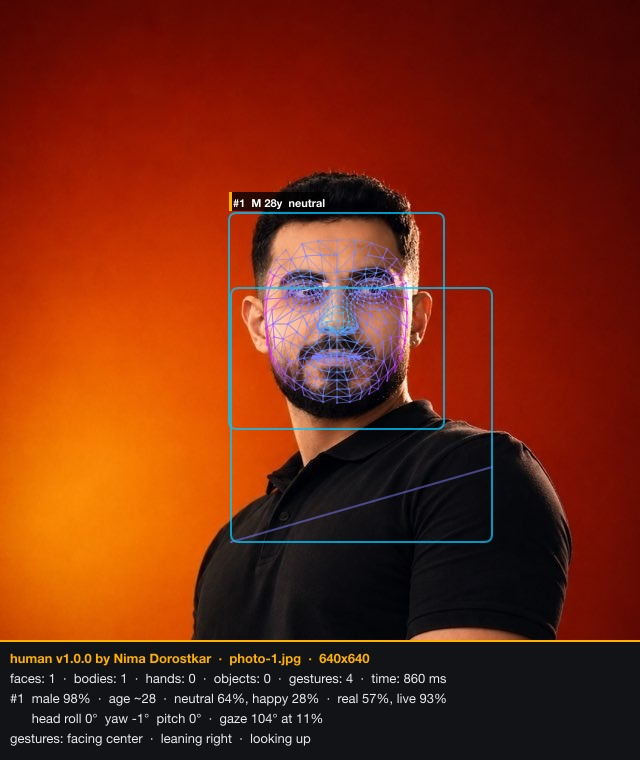
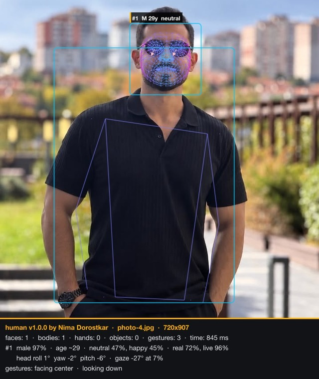
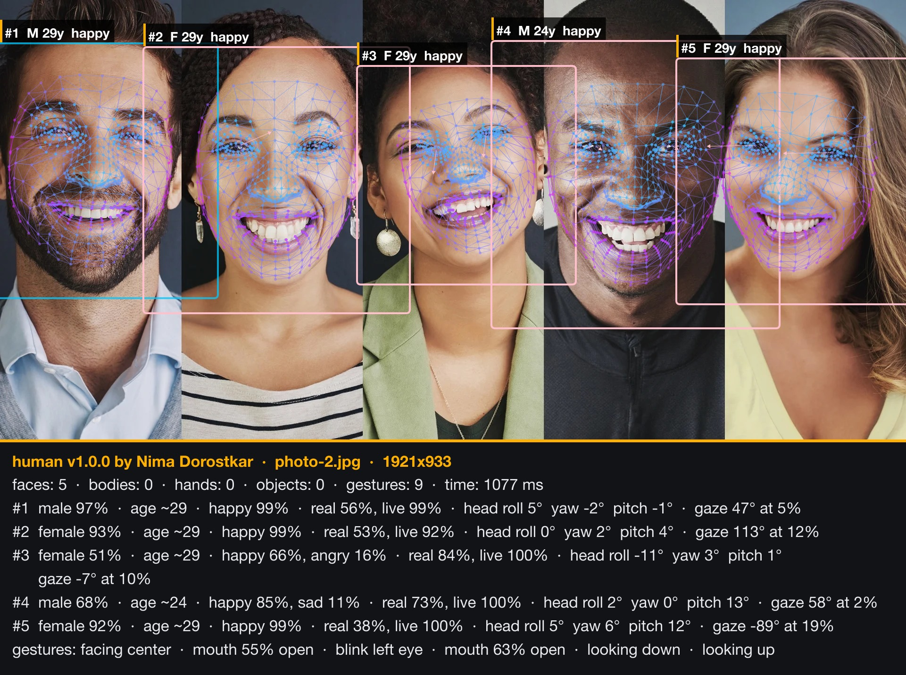

# human


**Real-time AI vision for the browser and Node.js.** Face mesh, iris and gaze, age, gender and emotion, face recognition, body pose, hands and fingers, gestures and objects, all running on-device.

By **Nima Dorostkar** · [Live demo](https://nimadorostkar.github.io/human/) · [npm](https://www.npmjs.com/package/@nimadorostkar/human) · [API docs](typedoc/index.html)

[](assets/results/result-3.jpg)

| | |
| --- | --- |
| [](assets/results/result-1.jpg) | [](assets/results/result-4.jpg) |

[](assets/results/result-2.jpg)

## Features

- **Face:** 3D detection and rotation, 468-point mesh, iris and gaze, age, gender, emotion, face descriptor for recognition, anti-spoofing and liveness
- **Body:** pose for one or many people, body segmentation
- **Hands:** 3D hand and finger tracking
- **Scene:** object detection and gesture recognition
- **Fast:** WebGPU, WebGL, WASM and CPU backends, web workers, frame-change detection and smooth interpolation
- **Private:** everything runs locally; images and video never leave the device

## Quick start

```bash
npm install @nimadorostkar/human
```

```js
import { Human } from '@nimadorostkar/human';

const human = new Human({ modelBasePath: '/models/' }); // serve node_modules/@nimadorostkar/human/models
const canvas = document.getElementById('output');

await human.webcam.start({ crop: true });
human.video(human.webcam.element); // detection loop

function draw() {
  human.draw.canvas(canvas, human.webcam.element);
  human.draw.all(canvas, human.next()); // smoothed results
  requestAnimationFrame(draw);
}
draw();
```

No build step? Load it from a CDN:

```html
<script src="https://cdn.jsdelivr.net/npm/@nimadorostkar/human/dist/human.js"></script>
<script>const human = new Human.Human({ modelBasePath: 'https://cdn.jsdelivr.net/npm/@nimadorostkar/human/models/' });</script>
```

In Node.js, load a TensorFlow backend first:

```js
require('@tensorflow/tfjs-node');
const { Human } = require('@nimadorostkar/human');
const human = new Human({ modelBasePath: 'file://node_modules/@nimadorostkar/human/models/' });
human.detect(imageTensor).then((result) => console.log(result.face));
```

`human.detect()` accepts images, videos, canvases, `ImageData`, `ImageBitmap` and tensors. Full options are in [`src/config.ts`](src/config.ts).

## Run locally

Requires Node.js 22 ([`.nvmrc`](.nvmrc)).

```bash
git clone https://github.com/nimadorostkar/human.git && cd human
npm ci --ignore-scripts
npm run serve
```

Open <http://localhost:8000> for **Vision Studio**, the main demo. Models and the pre-built library are included, so it works offline.

| Demo | What it shows |
| --- | --- |
| [Vision Studio](demo/index.html) | Every model live on webcam, video or photos, with filters and stats |
| [Simple](demo/typescript) | Minimal annotated webcam app in TypeScript |
| [Face Match](demo/facematch) · [Face ID](demo/faceid) | Face recognition and liveness checks |
| [Multi-thread](demo/multithread) · [Tracker](demo/tracker) · [Segmentation](demo/segmentation) | Workers, tracking and background removal |
| [Node.js](demo/nodejs) | Files, folders, video, webcam and batch processing |

Annotate a folder of photos, as in the images above:

```bash
npm rebuild @tensorflow/tfjs-node canvas   # once, for Node.js demos and tests
node demo/nodejs/node-analyze.js <input-folder> <output-folder>
```

## Scripts

| Command | Description |
| --- | --- |
| `npm run serve` | Dev server on <http://localhost:8000> |
| `npm run dev` | Dev server with watch and rebuild |
| `npm run build` | Production build of `dist/`, `types/` and `typedoc/` |
| `npm run lint` · `npm run typecheck` | Code checks |
| `npm test` | Node.js test suite |

## Deploy

- **GitHub Pages:** pushes to `main` publish the demos automatically ([pages.yml](.github/workflows/pages.yml))
- **Docker:** `docker build -t human . && docker run -p 8080:8080 human` (nginx, security headers, `/healthz`)
- **npm release:** push a tag like `v1.0.1` matching `package.json`; [release.yml](.github/workflows/release.yml) publishes it (needs the `NPM_TOKEN` secret)

## Links

[Changelog](CHANGELOG.md) · [Contributing](CONTRIBUTING) · [Security & privacy](SECURITY.md) · [License (MIT)](LICENSE)

## Author

**Nima Dorostkar** · [@nimadorostkar](https://github.com/nimadorostkar) · <nimadorostkar97@gmail.com>
